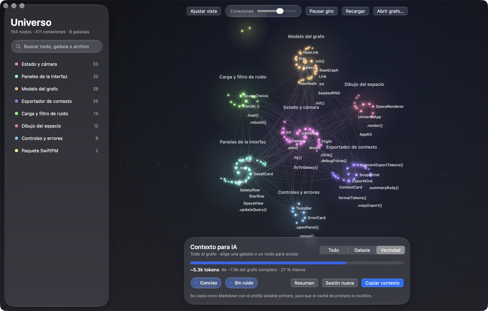
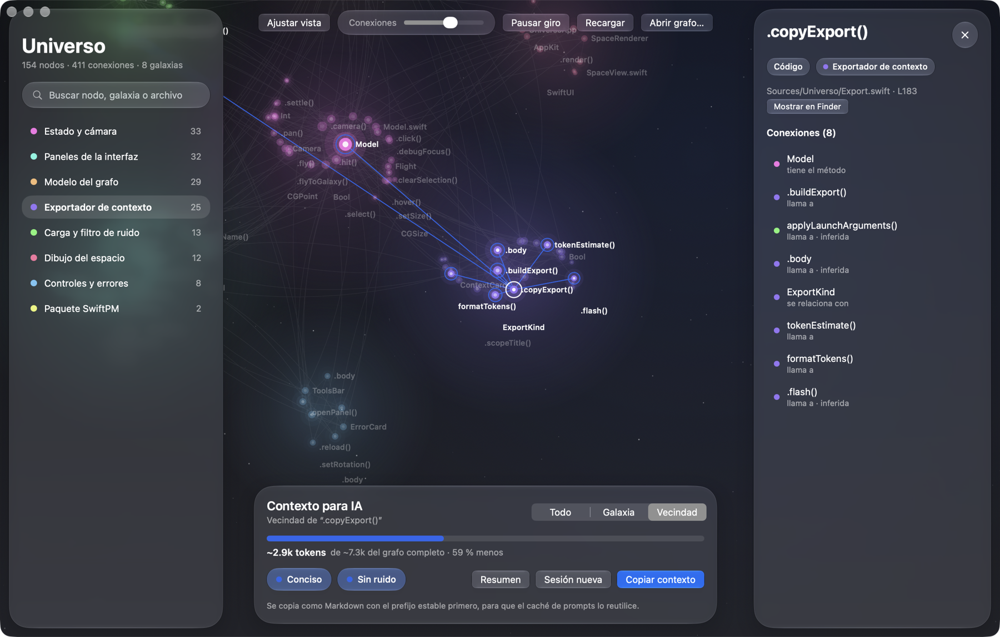

# universo

app nativa de macos que dibuja un grafo de [graphify](https://github.com/Graphify-Labs/graphify) como galaxias y copia solo el contexto que necesitas para una sesión con ia. menos tokens, el mismo mapa.



cada comunidad del grafo es una galaxia y cada nodo una estrella. arrastras, haces zoom, buscas y haces clic en una estrella para ver sus conexiones. lo que sirve para ahorrar tokens es el panel de abajo: eliges qué parte del grafo mandas (todo, una galaxia o la vecindad de un nodo), ves cuánto pesa y lo copias en markdown.

## ahorro de tokens

| técnica | en la app |
|---|---|
| resumen estático del proyecto | botón **resumen**: los nodos más conectados de cada galaxia |
| modo conciso | chip **conciso**: una línea por nodo, sin prosa |
| menos ruido | chip **sin ruido**: oculta nodos de yaml, json y xml |
| caché de prompts | lo copiado lleva primero un prefijo fijo y al final lo que cambia, para que el caché lo reutilice. el orden está pensado; el aprovechamiento depende de tu proveedor y la app no lo mide |
| markdown | todo se copia como markdown |
| rotar sesión y acotar alcance | selector **todo / galaxia / vecindad** y botón **sesión nueva**, un prompt listo para pegar |



en la captura, la vecindad de `copyExport()` pesa ~2.9k tokens contra ~7.3k del grafo completo. los tokens son una estimación (caracteres entre 4), no un conteo exacto.

## usar

requisitos: macos 26 y swift 6.

```bash
./build.sh
open build/Universo.app
```

abre un `graph.json` con ⌘O o arrastrándolo a la ventana, y ⌘R lo recarga. en `examples/universo.graph.json` está el grafo del propio código de universo, generado con graphify.

## capturar la ventana

`--graph`, `--select`, `--scope`, `--noise off`, `--toast` y `--live` permiten capturar la ventana real sin darle permiso de grabación de pantalla. las imágenes de este repo salen así:

```bash
build/Universo.app/Contents/MacOS/Universo \
  --graph examples/universo.graph.json --select copyExport --live captura.png
```

`--toast` copia el contexto al portapapeles.

## licencia

mit.
